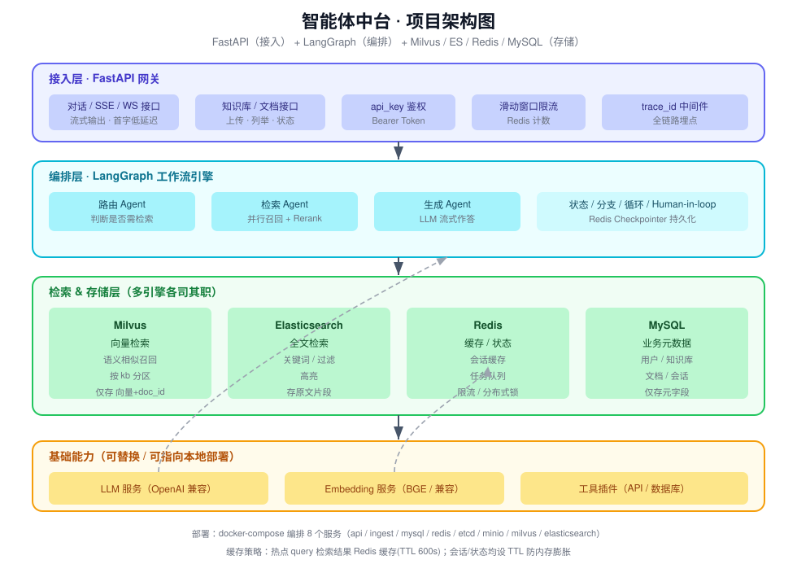
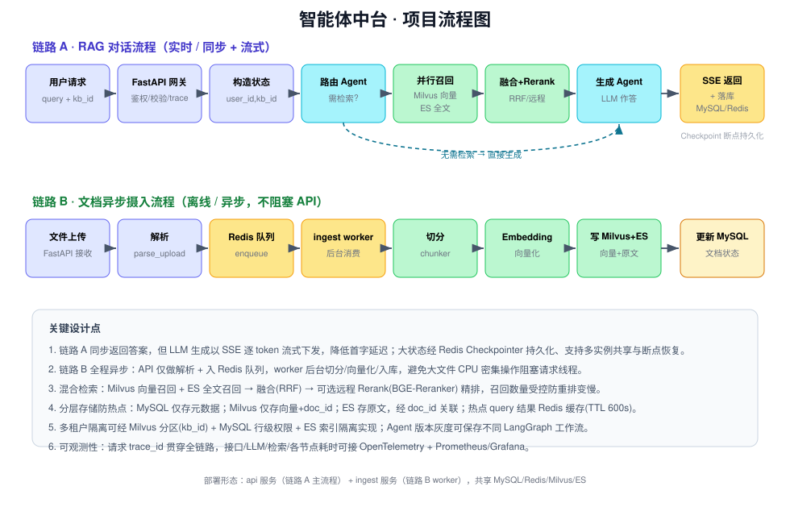
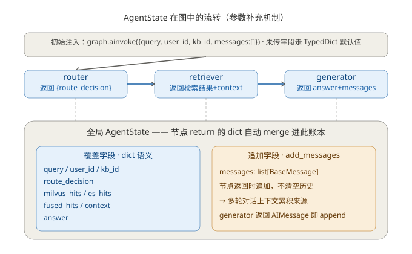

# 智能体中台（Agent Platform）

基于《FastAPI + LangGraph + Milvus + ES + Redis + MySQL 高性能智能体中台方案》实现的**可部署项目骨架**。

## 架构总览

```
┌──────────────────────────────────────────────┐
│ 接入层：FastAPI（HTTP/SSE、鉴权、限流、trace）   │
└───────────────────┬──────────────────────────┘
                    ↓
┌──────────────────────────────────────────────┐
│ 编排层：LangGraph RAG 工作流                   │
│  router → retriever → generator（Redis Checkpointer）│
└───────────────────┬──────────────────────────┘
                    ↓
┌──────────────────────────────────────────────┐
│ 检索/存储层                                     │
│  Milvus(向量) + ES(全文) → Rerank 融合          │
│  Redis(缓存/限流/队列/Checkpoint)              │
│  MySQL(业务元数据)                             │
└──────────────────────────────────────────────┘
```

## 组件与职责

| 组件 | 职责 | 目录 |
|------|------|------|
| FastAPI | 网关：对话(SSE)、知识库上传、鉴权、限流 | `api/` |
| LangGraph | Agent 编排：路由/检索/生成节点、Redis 持久化 | `langgraph_service/` |
| ingest | 异步文档摄入：解析→切分→向量化→入库 | `ingest/` |
| Milvus | 向量语义检索（按 kb 分区） | `db/milvus/` |
| ES | 全文检索 + 原文存储 | `db/es/` |
| Redis | 缓存/限流/任务队列/Checkpoint | `db/redis/` |
| MySQL | 用户/知识库/文档/会话/消息元数据 | `db/mysql/` |

## 快速部署（Docker Compose）

```bash
# 1. 准备环境变量
cp .env.example .env
# 按需修改 .env：LLM_*/EMBED_* 指向你的模型（支持本地 OpenAI 兼容网关）
# 生产务必修改 AUTH_SECRET、API_KEY_DEFAULT、ES/Mysql 密码

# 2. 构建并启动全部服务
docker compose --env-file .env up -d --build

# 3. 查看日志
docker compose logs -f api
```

启动后 API 监听 `http://localhost:8000`。

## 验证流程

```bash
# 健康检查
curl http://localhost:8000/health

# 1) 创建知识库（使用默认密钥 dev-key-123456）
curl -X POST http://localhost:8000/api/knowledge \
  -H "Authorization: Bearer dev-key-123456" \
  -H "Content-Type: application/json" \
  -d '{"name":"测试知识库"}'
# 返回 {"id":1,"name":"测试知识库"}

# 2) 上传文档（异步摄入）
curl -X POST http://localhost:8000/api/knowledge/1/documents \
  -H "Authorization: Bearer dev-key-123456" \
  -F "file=@README.md"
# 返回 {"task_id":"...","doc_id":1,"status":"queued"}
# 等待 worker 处理（查 status=2 表示完成）
curl http://localhost:8000/api/knowledge/1/documents \
  -H "Authorization: Bearer dev-key-123456"

# 3) 流式问答（SSE）
curl -N -X POST http://localhost:8000/api/chat/stream \
  -H "Authorization: Bearer dev-key-123456" \
  -H "Content-Type: application/json" \
  -d '{"query":"这个中台用了哪些存储组件？","kb_id":1}'

# 非流式
curl -X POST http://localhost:8000/api/chat \
  -H "Authorization: Bearer dev-key-123456" \
  -H "Content-Type: application/json" \
  -d '{"query":"这个中台用了哪些存储组件？","kb_id":1}'
```

## 本地开发（不依赖 Docker）

需要本地已运行 MySQL/Redis/Milvus/ES，并安装依赖：

```bash
python -m venv .venv && source .venv/bin/activate
pip install -r requirements.txt
export $(grep -v '^#' .env | xargs)   # 或在 core/config.py 直接读取 .env
python -m api.main                    # API 服务
python -m ingest.worker               # 摄入 worker（另开终端）
```

> 若 Redis 不可用，Checkpointer 自动降级为内存版；其余组件缺失时对应功能报错，不影响启动。

## 关键设计点（对应文章避坑清单）

1. **LangGraph 状态共享**：使用 `RedisSaver` 作为 Checkpointer，支持多实例共享会话、断点恢复；不可用时降级内存。
2. **Milvus 只存向量**：仅存 `doc_id + 向量 + 元字段`，原始长文本存 ES，通过 `doc_id` 关联。
3. **摄入异步化**：上传仅解析入 Redis 队列，worker 后台切分/向量化，绝不阻塞 API 请求。
4. **分层存储**：MySQL 仅存元数据；热点 query 检索结果 Redis 缓存（TTL 600s）；会话/缓存均设 TTL 防内存膨胀。
5. **混合检索 + 重排**：Milvus 向量召回 + ES 全文召回，融合采用 RRF；配置 `RERANK_ENDPOINT` 可切换为 BGE-Reranker 精排。
6. **流式输出**：SSE 逐 token 返回，降低首字延迟；全链路 `trace_id` 贯穿日志。

## 生产化建议

- LLGraph 独立部署为 LangGraph Platform（本文为进程内嵌入 + Redis Checkpointer，已满足分布式状态共享）。
- MySQL 改用 Alembic 迁移；ES 开启安全与 TLS；Milvus 升级为分布式集群。
- 接入 OpenTelemetry + Prometheus/Grafana 全链路监控。
- 限流、重试、熔断在 LLM 代理层统一处理。

## 架构与流程图



*图 1：分层架构 —— 接入层(FastAPI) / 编排层(LangGraph) / 检索&存储层(Milvus+ES+Redis+MySQL) / 基础能力。*



*图 2：两条主链路 —— 链路 A 为 RAG 实时对话（同步+流式），链路 B 为文档异步摄入（不阻塞 API）。*



*图 3：LangGraph 状态机制 —— 初始 state 注入、节点以 return dict 增量补充全局状态；`messages` 通道经 `add_messages` reducer 累加（橙色），其余字段为覆盖式合并（蓝色）。另提供 PNG 版本 `docs/agentstate_flow.png`。*

## 目录结构

```
agent-platform/
├── docker-compose.yml        # 全栈编排
├── Dockerfile                # 镜像（api / ingest 共用）
├── .env.example              # 环境变量样例
├── requirements.txt
├── api/                      # FastAPI 网关
├── langgraph_service/        # LangGraph 编排
├── ingest/                   # 异步摄入
├── db/                       # MySQL/Milvus/ES/Redis
└── core/                     # 配置/LLM/Embedding/Rerank/日志
```
